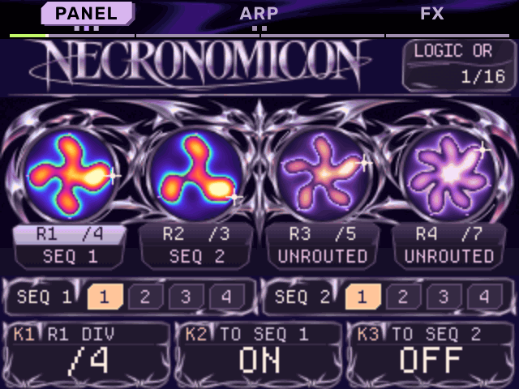
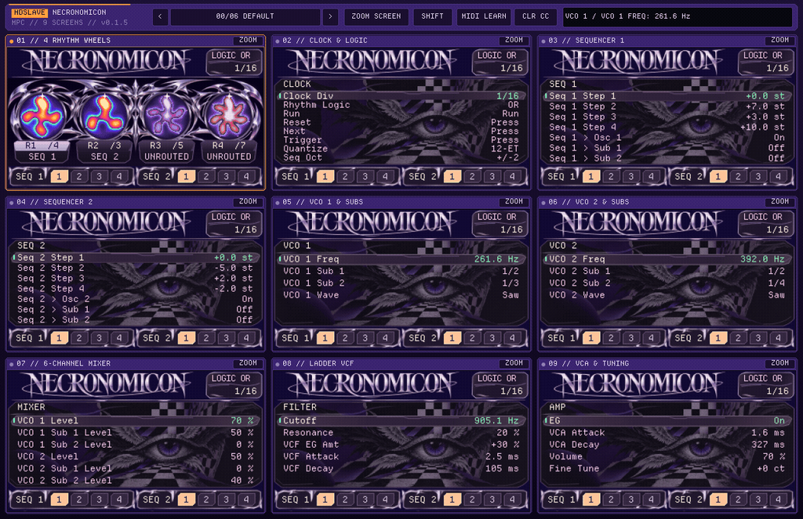

# hdslave Necronomicon

**A polyrhythmic subharmonic synthesizer (Subharmonicon panel & flow) as a CLAP plug-in for the Akai MPC Sample.**

<table>
  <tr>
    <th width="34%">MPC Sample</th>
    <th width="66%">macOS and Windows · CLAP</th>
  </tr>
  <tr>
    <td align="center"><a href="docs/necronomicon-screen.gif"></a></td>
    <td align="center"><a href="mac-clap/assets/desktop-preview.gif"></a></td>
  </tr>
</table>

> **Desktop CLAP version (macOS & Windows):** A separate desktop CLAP build with all MPC screens on one interactive panel lives in [**`mac-clap/`**](mac-clap/) (`cd mac-clap && ./install-macos.sh`). Releases in this repo stay MPC Sample-only for now while the desktop builds are being finalized.

Built for the Akai MPC Sample running [Melodee](https://github.com/keremimo/melodee-sample) / [hdslaveOS](https://github.com/hdslave/hdslaveOS) (64-bit ARM Linux, Cortex-A55). Hosts list it as **hdslave Necronomicon** (id `com.hdslave.necronomicon`). It follows the front panel and normalled signal flow of the Moog Subharmonicon (without the patch bay): two VCOs, each with two phase-locked subharmonic dividers (1/1 to 1/16), a 4-pole ladder filter, two AD envelopes, two 4-step sequencers, and four polyrhythmic rhythm generators with OR/XOR logic.

The rhythm generators divide the host clock — playing on the song's grid, stopping on stop, and staying aligned through song jumps. On Melodee 0.7 and hdslaveOS based on it, Necronomicon draws its animated **Liquid Light** screen with four stained-glass rhythm wheels tracking each divisor's phase and sequencer routing in real time.

## Signal flow

```
VCO 1 ──► SUB 1, SUB 2 (VCO 1's frequency / 1 … 16, locked to its phase)     VCO 2 ──► its SUB 1, SUB 2
VCO 1, its subs, VCO 2, its subs ──► mixer (six levels; overdrives when hot)
  ──► 4-pole ladder low pass (VCF EG moves the cutoff) ──► VCA (VCA EG) ──► Volume ──► out (stereo)

host clock (Clock Div) ──► RHYTHM 1 … 4 (every 1st … 16th clock) ──OR / XOR──► SEQ 1 and / or SEQ 2 (4 steps each)
SEQ 1 ──► VCO 1's pitch and / or its subs' divisors        SEQ 2 ──► the same for VCO 2
every step of either sequencer ──► both EGs (EG: On)
Run on: every note is a pad (36–51 pads 1–16, the banks above and below the same pads an octave a bank)
        ──► a step of SEQ 1 or SEQ 2, heard without moving the sequencer, an octave a bank, and both EGs
Run off: every note ──► both VCOs' pitch (from middle C) and a gate on both EGs
```

A subharmonic counts its VCO's cycles, so it stays locked to it in phase whatever the VCO does: VCO 1 at C and its
subs at 1/3 and 1/5 are a C with the F and the A-flat of the subharmonic series below it, exactly in tune.

## Liquid Light

Edit on the plug-in track and PANEL on Stage show one stained-glass window for each rhythm generator. Its clock divisor sets the number of lobes, and the white glint follows the current lobe. Read the two four-step strips below the windows to see which sequencers actually advanced under OR or XOR. Each window names the sequencers it feeds. [Screen captured in Melodee](assets/previews/liquid-light.png)

Turn the wheel to select a generator. K1 changes its divisor, K2 routes it to Seq 1 and K3 routes it to Seq 2. Push the wheel to edit the divisor with detents and push again to finish. Minus and Plus visit the clock, sequencer, oscillator, mixer, filter and amp controls. On those pages the wheel selects a row, Push edits it or presses its button, and K1–K3 follow the selected row and the next two. Shift shows the controls. A hollow marker beneath a knob value shows the physical pot position until pickup.

The plug-in embeds native-size lens frames for all sixteen divisors. The Silver Thorn panel frames the four wheels in polished chrome. Routed wheels use the vivid stained-glass palette. An unrouted wheel moves from ember orange through violet to cobalt and back every four bars of host transport. It follows tempo changes and song jumps, and holds its color on stop. Behind the parameter list, Parallax Rite frames a deep-purple iris with engraved wings, torn paper and checkerboard tiles. The eye glances slowly and occasionally blinks. The static Silver Thorn serif and its orbit line pick up the violet and blush reflections of the wheel frames. Forked chrome spikes frame the sequencer strips and knob panels. A longer silver point divides each label from its neighboring control, with the text set against smoked violet. The current steps light in amber. Each knob panel pairs its K number and parameter name above a centered value. The screen uses Departure Mono by Helena Zhang under the [SIL Open Font License](licenses/OFL-departure-mono.txt).

## Controls

The public controls, in host parameter order.

| Necronomicon | Panel | Range |
|---|---|---|
| VCO 1 Freq, VCO 2 Freq | VCO 1 FREQ, VCO 2 FREQ | Middle C (261.6 Hz) to the top C (4,186 Hz), 4 octaves |
| VCO 1 Sub 1, VCO 1 Sub 2, VCO 2 Sub 1, VCO 2 Sub 2 | SUB 1 FREQ, SUB 2 FREQ (each VCO) | 1/1 … 1/16 of the VCO's frequency |
| VCO 1 Level … VCO 2 Sub 2 Level | the six mixer levels | 0 – 100 %; together they overdrive when hot |
| VCO 1 Wave, VCO 2 Wave | VCO 1 WAVE, VCO 2 WAVE | **Square**: the VCO and its subs square. **Pulse/Saw**: the VCO a pulse whose width its SUB 1's sawtooth sweeps (the panel's normalled PWM), the subs sawtooth. **Saw**: all three sawtooth |
| Quantize | QUANTIZE | Off / 12-ET / 8-ET / 12-JI / 8-JI: the VCOs' pitch (knob, step and note together) to the nearest note of a scale on C |
| Cutoff | CUTOFF | 20 Hz – 20 kHz |
| Resonance | RESONANCE | 0 – 100 %; self-oscillates from about 90 % |
| VCF EG Amt | VCF EG AMT | ±100 %: the VCF EG moves the cutoff up to 8 octaves up or down |
| VCF Attack, VCA Attack | VCF ATTACK, VCA ATTACK | 1 ms – 10 s |
| VCF Decay, VCA Decay | VCF DECAY, VCA DECAY | 5 ms – 10 s (time to fall 60 dB) |
| EG | EG button | **Off**: the steps start nothing (Trigger and notes still do). **On**: every step of either sequencer starts both EGs. **Hold**: both EGs rise to the top and stay there (a drone); leaving Hold, they decay |
| Volume | VOLUME | 0 – 100 % |
| Seq 1 Step 1–4, Seq 2 Step 1–4 | STEP 1–4 (each sequencer) | ± Seq Oct: centre is no change; the text reads in semitones at the Seq Oct setting |
| Seq Oct | SEQ OCT | ±1 / ±2 / ±5 octaves, for both sequencers |
| Seq 1 > Osc 1, Seq 1 > Sub 1, Seq 1 > Sub 2 | SEQ 1 ASSIGN: OSC 1, SUB 1, SUB 2 | Off / On, any together. On **Osc**, the step moves the VCO's pitch (its subs follow it). On a **Sub**, the step moves that sub's divisor instead: 3 divisors for each octave of step, up a smaller divisor (a higher note) |
| Seq 2 > Osc 2, Seq 2 > Sub 1, Seq 2 > Sub 2 | SEQ 2 ASSIGN | the same for VCO 2 and its subs |
| Rhythm 1–4 | RHYTHM 1–4 | 1 – 16: the generator fires on every n-th clock |
| Rhythm 1 > Seq 1 … Rhythm 4 > Seq 2 | each RHYTHM's SEQ 1 and SEQ 2 buttons | Off / On: the sequencers it moves |
| Rhythm Logic | Rhythm Generator Logic (a MIDI setting on the panel) | **OR**: a sequencer moves when any of its generators fires. **XOR**: only when exactly one does (two together cancel) |
| Clock Div | TEMPO (replaced) | 1/2 … 1/64 of a beat, with triplets: the clock the generators divide (1/16 is four a beat, the panel's own clock under MIDI clock) |
| Run | PLAY | Stop / Run: with Run off the host plays but the sequencers hold and nothing fires. Run also decides what the pads do: on, pads 1–16 play the steps; off, they play notes (below) |
| Reset | RESET | both sequencers to step 1 and the generators to their start: the next clock fires every routed generator and plays step 1 |
| Next | NEXT | both sequencers on one step, without the EGs |
| Trigger | TRIGGER | both EGs at once, without moving the sequencers (not during an attack; in EG: Hold, only sounds the drone again after an All Sound Off) |
| Fine Tune | OSC 1 + OSC 2 held, TEMPO turned | ±50 cents on both VCOs |

### Pads and notes

**Sequencer on (Run: Run), pads 1–16 play the steps; off (Run: Stop), the pads play notes.** Since 0.3.0 the plug-in
carries a drum map in its file (the form Melodee reads from a drum machine's library), so on hdslaveOS (and Melodee) a
plug-in track on it plays its pads as Drums: pads A01–A16 send notes 36–51, pad 1 at the bottom left, whatever the
track's octave, key or scale, and the Keys page names them (S1 Step 1 … S2 Step 4, twice). The − / + buttons then
move the pad **bank** instead of the octave: bank B sends 52–67, C 68–83, D 84–99. While Run is on, the plug-in reads
any note as a pad and a bank: pad = (note − 36) mod 16, bank = (note − 36) div 16 (rounded down), the bank held to
three above A and two below. A bank is an octave: every bank plays the same 16 pads, 12 semitones higher a bank up
(banks A–D: 0, +1, +2, +3 octaves).

- **Run on, whether or not the song plays:** each pad is a step. The bottom row (pads 1–4) is Seq 1's steps 1–4,
  the second row (pads 5–8) Seq 2's steps 1–4, and the top two rows (pads 9–16) the same again; in every bank. A pad
  plays its step as the sequencer would on reaching it: the step's value goes to wherever that sequencer is routed
  (its VCO's pitch, its subs' divisors), quantized, at the current transposition plus its bank's octaves (bank B's
  pad 1, note 52, is Seq 1's step 1 an octave up), and both EGs start as Trigger starts them (in EG: Off too; in
  EG: Hold the drone just moves, and sounds again after an All Sound Off). The sequencer itself does not move: its
  next step at a clock (or Reset, or Next, or a Play or jump lining the steps up with the song again) takes over,
  with no octave left over, and the pattern carries on where it was. A pad plays once (letting go of it does
  nothing) and holds no gate. Two pads on one frame: one of each sequencer both apply; two of one sequencer, the
  later wins; the EGs start once. A pad on the very frame a clock steps its sequencer gives way to that step.
- **Run off:** every note plays its own pitch, exactly as before 0.3.0: it moves both VCOs by its distance from
  middle C (note 60), as the panel's VCO 1 input does (normalled to VCO 2), and holds both EGs at the top while it is
  down. Bank B's pad 1 (note 52) plays 52, 16 semitones above bank A's pad 1; the banks are not octaves here. The
  pitch stays where the last note put it, so notes played with Run off transpose the pattern when Run goes on again.
  With EG: Off and the transport stopped, the pads play the synth like a monophonic keyboard.
- **What 0.3.0 replaced:** before it, with Run on, notes outside 36–51 transposed the running pattern and gated the
  EGs as notes. They are now step pads in their bank (above). A project saved with notes outside 36–51 played while
  Run is on (a MIDI clip, an external keyboard) plays them as steps; with Run off nothing changed.
- There are no drum voices; nothing plays a fixed sound per pad.

A note off and Melodee's All Notes Off (CC 123) end only notes held as notes: a pad's step is never held, so they
never touch it, and a pad's note off never ends another held note. All Sound Off (CC 120, or a choke for every key)
is the exception: it silences the sounding voice at once, an EG: Hold drone included. A choke for one key ends that
key as a note off does, and once no key is held it silences the voice as All Sound Off does (a key under another one
still held only leaves the held list). While the song plays in EG: On, the sequencer keeps running and its next step
sounds again; otherwise the voice stays silent until a note, Trigger or an EG change sounds again.

## Presets

Six factory presets, inside the plug-in: Melodee lists them on the plug-in's PRESETS page (any host with CLAP preset
discovery does). A preset sets every control, the sequencers and the rhythm generators too; Default puts everything
back.

| Preset | What it is |
|---|---|
| Default | VCO 1 on C with an octave sub, VCO 2 on G with a sub two octaves down; Seq 1 on every 4th sixteenth, Seq 2 on every 3rd |
| Subharmonic Chords | 12-JI, each VCO's subs a few subharmonics below it, slow envelopes, the sequencers walking chord tones on 8 and 6 |
| Polyrhythm Bass | Low saws in 3 against 4, a third generator on 7 into both sequencers, Seq 2 moving VCO 2's sub divisor |
| PWM Pad | Both VCOs in Pulse/Saw (their widths swept by their SUB 1s), long attacks, changes on 16 and 12 |
| Sub Arp | The sequencers on the subs' divisors only: a subharmonic arpeggio, three generators under XOR |
| Hold Drone | EG: Hold, just intonation, a resonant filter, the sequencers retuning the drone on slow rhythms |

They are the patches the demo renders play: the tests load each preset and check it gives the same values and the
same samples as the demo's list.

## Clocking from the host

- A clock falls on every multiple of Clock Div counted from the song's top, while the host plays. Rhythm n fires on
  every n-th clock from the top, so all four fire together on the song's first clock and line up again on their
  common multiples. Each sequencer moves a step when its generators fire (by the logic), and the first time after a
  Play, a jump or Reset it plays the step it is on.
- Play from the top starts on its first frame; each later clock lands on its frame. A Play or a jump places both
  sequencers by the song's place: the steps the generators would have reached from the top.
- Stop stops the clock (sounds ring out; EG: Hold keeps droning). A jump, or a loop going round, lines everything up
  with the song's place again. A Play or jump landing just past a clock (within a block) plays that clock at once.
- A loop that wraps inside a block is told only at the next block (Melodee tells the song's place at its own blocks,
  even when it plays a plug-in in smaller parts), so the clocks run on to the loop's end, which is its start: the
  clock played there stands for the downbeat. When the host tells, the steps line up with the song and the EGs are
  not started twice; a downbeat the loop's end left silent plays then, at most a block late (2.7 ms at 128 frames).
- A tempo change inside a block moves the host's place a few frames from where the clock counted: followed as it is,
  no clock played twice, a clock passed played at once.
- So does a place a little off its line, either way, by up to a 64th note: hdslaveOS works the place out from its
  ticks, so a swung tick, a tick on a block's edge or MTC's trim puts it up to 0.0021 of a quarter off from block to
  block, and a plug-in two tracks play is run twice a block (its next block's first call told a block back). A step
  back holds the clocks already played until the song is past them again. Before 0.2.5 a step back of more than the
  call's own frames counted as a jump: with the calls in parts, at slow tempos or run twice a block, a clock could play
  twice or be lost (at 40 BPM with the place up to 0.002 of a quarter off, 57 of 192 clocks of 1/32 played twice). A
  move of more than a 64th note is a jump, as before (exactly a 64th, as hdslaveOS has it, is not).
- Clock Div changed while playing: the clocks count on the new grid from there; one due on that frame plays. While the
  place is held behind the clocks played (above), they count from where the clocks got to, so none plays again.
- Run off: the host plays but the sequencers hold their steps and nothing fires; Next, Reset and Trigger work as on
  the panel, and the pads play notes (Pads and notes, above). Reset while playing restarts the generators from the
  next clock (a Clock Div change after it keeps that moment), until the next Play or jump lines them up with the song
  again.
- In Melodee, keep the plug-in's **TRANSPORT** on (the default): with it off the plug-in never hears Play.

## Where values were inferred

The Subharmonicon's manual documents the routing and several ranges (VCO 4 octaves from middle C, divisors 1–16,
cutoff 20 Hz – 20 kHz, attacks 1 ms – 10 s, decays 5 ms – 10 s, SEQ OCT ±1/±2/±5, rhythms 1–16, the OR / XOR logic,
the three WAVE positions, a trigger ignored during an attack, fine tune ±50 cents). It does not give these, so they
are chosen to match what is documented:

- VCF EG depth: ±8 octaves at full turn.
- Resonance: the ladder self-oscillates from about 90 % of the turn (the manual: at its maximum).
- Pulse/Saw: SUB 1's sawtooth sweeps the pulse between 5 % and 95 % (the PWM input's range is 1 – 99 %).
- A step on a sub moves its divisor by 3 for each octave the step is worth (the manual says only that it changes the
  divisor). A new divisor takes over at the VCO's next cycle.
- The scales: 8-ET and 8-JI are the eight notes of a major scale (8-JI's ratios are the manual's just C major:
  1/1 9/8 5/4 4/3 3/2 5/3 15/8 2/1); 12-JI is the 5-limit chromatic scale (1/1 16/15 9/8 6/5 5/4 4/3 45/32 3/2 8/5
  5/3 16/9 15/8). All on C. The knob, the step and a note are quantized together, then Fine Tune.
- XOR with three or four generators on a sequencer: it moves when exactly one fires. The logic is the same for both
  sequencers, each with its own generators.
- A trigger during a decay starts the attack from where the envelope is.
- The mixer's overdrive: one soft-clipping stage after the six levels (squared tapers).

Deviations: Trigger is a trigger in EG: Off as in On (on the panel it is a gate there; a plug-in button cannot be
held, so the gate is left to MIDI notes, which hold the EGs as a gate does); notes carry no velocity, as on the panel.
The pads as steps (Run on) and the banks are this plug-in's own: the panel has no pads.

Left out on purpose: the patch bay, the external clock, MIDI CCs, the PWM input and the SEQ OCT / QUANTIZE output
settings (there are no outputs), and the panel's TEMPO (the clock is the host's; 1/64 is the fastest).

## Cost

One voice, run at twice the host's rate (so the oscillators' edges and the ladder stay clean) and filtered back
down with a half-band FIR. All six oscillators' edges are band-limited with polynomial BLEP: away from the
harmonics, each output stays 45 dB or more below them at 1 and 3 kHz (`tests/unit.cpp` checks it). Instructions a
128-frame block takes, from `tools/bench.sh` (callgrind):

| Case | Instructions | Share of one A55 core at 1 instruction a cycle |
|---|---|---|
| Everything busy (all six oscillators sounding, the pulse width swept, a high VCO, the sequencers on the subs, resonance, EG: Hold) | about 79,000 | 1.6 % |
| The default pattern with a shorter decay | about 40,000 | 0.8 % |
| Stopped | under 600 | 0.01 % |

While the VCA is closed between hits the oscillators and filter are skipped. A VCO's increment and the filter's
gain are worked out again only when what they come from moves (the pitch eases only every 8 frames; the cutoff
stands still while the VCF EG rests or holds): an eighth less in the busy case, the same output to the bit. The
real share on the MPC depends on how many instructions the A55 retires a cycle on this code; measure it with
Melodee's plug-in load figure.

## Build and test

Needs Docker with a Linux arm64 context (Melodee's `colima-melodee` and its `melodee-builder` image by default).

```sh
./build.sh          # build/Necronomicon.clap, then the tests, the sound's fingerprint and demo renders build/demo-*.wav
./build.sh bench    # build/bench
./build.sh sanitize # the unit and host tests against a build with AddressSanitizer and UBSan (build/san/)
tools/bench.sh      # instruction counts (Melodee's melodee-profiler image)
```

`tests/unit.cpp` checks the engine below the CLAP API: the rhythm generators' counting by common multiples against
counting clock by clock (3,000 random routings, both logics), the scales, the subs locked to their VCO through
random pitch changes and divisor changes, and every output's aliasing.

`tests/host.cpp` loads the plug-in through the CLAP API and checks: description and ports; every parameter's range,
text and default (the steps' text following Seq Oct, the host asked to read it again); state save and load; the
presets as preset discovery lists them and preset-load loads them; clock timing to the frame at 44.1, 48 and 96 kHz
and two tempos; 3 against 4 across the sequencers, OR and XOR on one; a generator routed nowhere, Run off; stop,
restart, jumps, a host without a song position, the steps placed by the song's place, a count-in from beat -1; a loop
wrapping inside a block and told a block late (one hit on the downbeat, not two; a downbeat the loop's end left
silent still played, in whole blocks and in Melodee's smaller parts), a tempo change inside a block, the place off its
line (up to 0.002 of a quarter either way, also in parts; swing 60's ticks; run twice a block; at 127 and 40 BPM: each
clock once, near its place) and moved back under and over a 64th note, Clock Div changed on a downbeat, Reset and Clock Div in one block;
the same output whatever the block size (1, 37, 128, 4096 frames); the VCO range, each quantizer, Fine Tune; Next,
Reset, the steps on the VCO and on a sub's divisor, a sub following its VCO, Seq 2 on VCO 2, each wave's pitch;
EG Off with Trigger, EG Hold and back, notes (CLAP, MIDI, a choke, a note off for any key) gating the EGs and moving
the pitch, Reset while playing; the pads as steps (Run on): each of the 16 pads, as a CLAP note and as MIDI, in EG: On,
Off and Hold, the same output to the bit as Next pressed up to its step with Trigger, after a note has transposed;
the sequencer not moved by a pad (stopped: Next then goes to the next step from where it was; playing: the next clock
plays the step it would have), a pad on Play's frame (mid-song it holds until the next clock; from the top the clock
on that frame takes over), a sequencer no generator moves keeping a pad's step, two pads on one frame (of one
sequencer the later wins, of both both apply, one hit), on, on, off of one pad (two hits, nothing held), a pad and its
off under a held note, a choke and a CC 120/123 storm on every channel, the banks (52, 68, 84, 20, 4, 61, 100, 127 and
120 playing bank A's step an octave a bank, three up and two down at most, as one hit), Run off keys 36, 52, 68, 84
and 20 at their own pitch as before 0.3.0, Run off (the pads notes again, held as a gate) and on again, the drum map in the binary (16 voices on
notes 36–51, named, the JSON balanced), and the same
output with pads inside blocks of 1, 37, 128 and 4096 frames, playing and stopped; a preset loaded while playing heard
exactly as its values sent as events; a choke for one key silencing the voice once no key is held, and leaving a key
still held sounding; All Sound Off silencing a Hold drone (All Notes Off not touching it), while
playing in EG: On only until the next step, Trigger sounding the drone again, a pad's step ending at a song jump,
a mid-grid Play landing the same at every block size, a page press the host slept on and one voided by a reset,
hostile tempos (0, 2000, nan, infinite) and sample rates, a state from a newer version refused, nan/inf text refused;
and finite, bounded output at 60 random and extreme settings, never stuck at the ceiling (what a NaN inside would
give).

`tests/fingerprint.cpp` then renders 50 fixed scenarios (each preset, the bench's patches, 24 random patches with the
buttons, notes and knobs moving, other block sizes and rates, stop and jumps, each quantizer and wave, notes while it
plays, XOR switched while it plays, a loop wrapping inside a block in whole blocks and in parts, the pads as steps
playing and stopped, the banks with Run on and off) and hashes every output sample's bits against `tests/fingerprint.txt`: work
meant to keep the sound, such as a speed-up, must leave every hash as it is. A change meant to change the sound
updates them with `make fingerprint-update` (run inside the build image). The hashes hold for Melodee's build image
and these compiler flags.

## Install

Copy `build/Necronomicon.clap` to `Melodee/Plugins/hdslave/hdslave Necronomicon.clap` on the card (or the staged
card's folder), then pick it on an empty track: Stage, Plugin, hdslave, hdslave Necronomicon. It needs only libc and libm, glibc 2.35 or
newer (the MPC has 2.39); the build is about 1.2 MB.

Version 0.3.0 (the drum map and the pad banks; 15 of 49 fingerprints moved, every one a scenario playing notes outside 36–51 with Run on, and 1 added) passed the Linux host tests above. Melodee 0.7.1 and hdslaveOS both rendered its custom screen at 0.2.3; the page is unchanged since. Not yet run on the MPC: the drum map, the banks and − / + are untested on the device.
